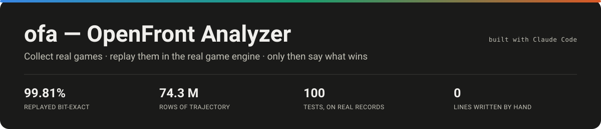
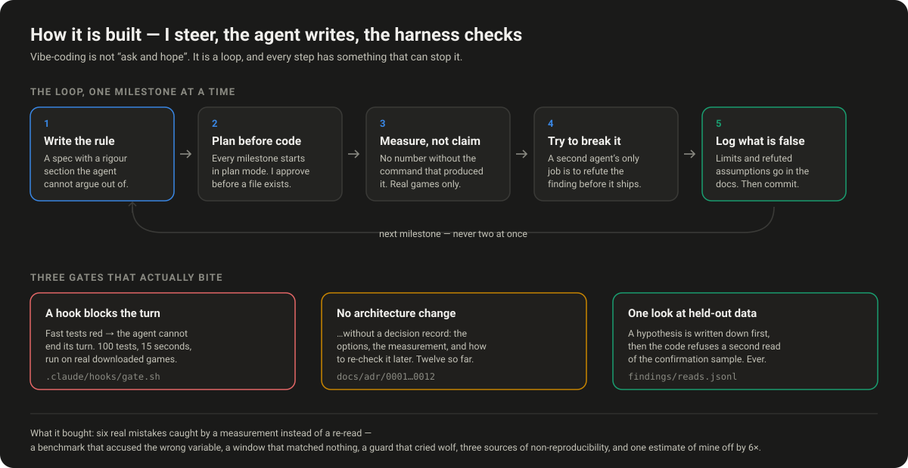
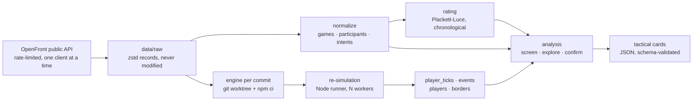
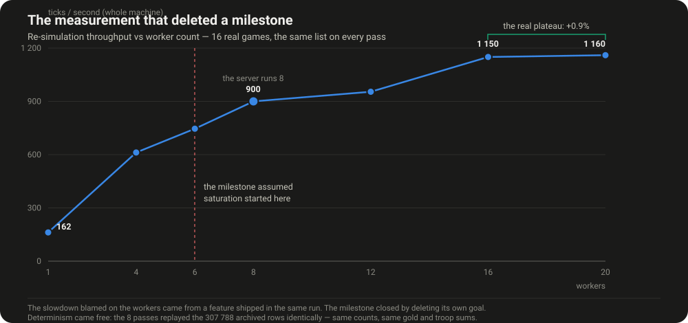

<p align="center">
  
</p>

<p align="center">
  
  
  
  
  
  
  
  
</p>

<p align="center">
  <a href="#what-it-does">What it does</a> |
  <a href="#how-i-built-it">How I built it</a> |
  <a href="#the-pipeline">Pipeline</a> |
  <a href="#the-measurement-that-deleted-a-milestone">What the harness caught</a> |
  <a href="#where-it-stands">Where it stands</a> |
  <a href="#run-it">Run it</a>
</p>

## What it does

[OpenFront.io](https://openfront.io) is a browser RTS. Its public API keeps every finished game,
but only the **ending**: final stats, the winner, and the list of **commands** players sent. Not
the game itself — no territory over time, no gold or troop curves, no alliance timeline, no
who-attacked-whom-when.

An order like *"attack tile T at tick 1234"* doesn't tell you what happened next. Only the engine
knows. So ofa replays each archived game **in the real game engine, built at the exact commit that
produced it**, and watches the state unfold. A replay counts only if every final stat it recomputes
is identical to the archive.

Then it looks for tactics that actually work — which is harder than it sounds, because the obvious
answer is always wrong. *Winners build more cities* is true and useless: they build more **because**
they're winning. So every claim here is measured inside a time window, against what happens
**after** that window, between players at equal rating, equal position and equal neighbourhood. If
it can't be measured that way, it doesn't get published.

**What came out of it**

- **513 of 514** eligible games replayed with every final stat identical to the archive —
  **74.3 million rows** of trajectory in 278 MB.
- A rating that beats both naive baselines on held-out games: log-loss **0.6367 vs 0.6931**, rank
  correlation **0.311 vs 0.109** for mere experience.
- An analysis engine that **can't fool itself**: a placebo behaviour returns nothing, a planted
  +0.10 effect comes back at ±0.02, and an effect that's really just player skill gets rejected
  even though its raw association is +0.4.
- Two findings that go against common wisdom, so far only on the exploration half: in Team mode,
  asking for an alliance early goes with **−13.6 points of team win rate**; in FFA, stacking
  defense posts early goes with **747 fewer ticks of survival**. Neither is published until the
  held-out sample agrees.

## How I built it

I never typed a line of this code. I typed rules, and read what came back.

<p align="center">
  
</p>

That's the whole trick. Left to itself, an agent writes plausible code and plausible numbers — and
on a statistics project, plausible numbers are the dangerous kind. So the project is set up so that
being wrong *costs something*:

- **The spec came first**, with a rigour section the agent can't negotiate: bootstrap by player and
  not by row, effect size before p-value, a minimum sample per group, and "if reality contradicts
  this spec, stop and say so".
- **Each milestone starts in plan mode.** I read the plan, I cut what I don't want, and only then
  does a file get written. Then it stops and waits for me.
- **Nothing is claimed without the command that produced it.** Tests run on ~20 real downloaded
  games; the engine is never mocked, because a mocked engine would agree with whatever I believe.
- **A second agent tries to kill every finding** before it ships. Its job isn't to help — it's to
  refute.
- **What turned out false stays written down.** `docs/PROGRESS.md` has the refuted assumptions, the
  bad estimates and the limits, milestone by milestone. That's the file that makes the next session
  as good as the last one.

As it stands: **4 371 lines of Python**, 753 of TypeScript, 1 897 of tests — and **3 661 lines
of documentation**. The docs aren't decoration; they're the part doing the steering.

<details>
<summary><b>The harness, file by file</b></summary>

| File | What it does |
|---|---|
| `docs/SPEC.md` | The contract: scope, non-negotiable constraints, the rigour rules, one milestone at a time. |
| `CLAUDE.md` | Loaded every session: commands, architecture rules that need a decision record to change, and the list of traps already paid for (`bigint` stats arrive as strings, `publicID` can be null or `REDACTED`, 1 tick = 100 ms, the engine is only deterministic at the record's own commit). |
| `.claude/hooks/gate.sh` | Fast tests red → the turn cannot end. |
| `.claude/hooks/format.sh` | Formats and lints every Python file as it's written. |
| `.claude/skills/tactic/` | `/tactic` — forces the full protocol on any tactical claim. |
| `.claude/agents/stats-reviewer.md` | The subagent that tries to refute a finding. |
| `.claude/rules/*.md` | Rules loaded only when the agent touches analysis or re-simulation. |
| `docs/adr/0001…0012` | Twelve decisions: the options, the measurement, and how to re-check it. |
| `docs/PROGRESS.md` | Done, numbers, decisions, limits — including everything that was wrong. |

</details>

## The skills I wired in, and why

A skill is a procedure the agent loads when it needs it, instead of me retyping instructions that
drift from one session to the next. Four earn their place here.

| Skill | Why it's there |
|---|---|
| **`/tactic`** · written for this repo | Any claim shaped like *"doing X helps you win"* has to go through it: pre-register the hypothesis, explore, confirm **once**, re-test with another definition and another time window, publish a schema-validated card, then hand it to the reviewer agent. Without it the natural move is to publish the first strong number — which is exactly how analytics projects end up wrong. |
| **`/analyze-player`** · written for this repo | The entry point for the last milestone: my own games against winners of the same level, on the same map, at the same moments. It exists already so the shape of that report is decided before the data lands. |
| **`dataviz`** · bundled | Used for the three images on this page. It picks the *form* before the colour and ships a **runnable palette validator** — lightness band, chroma floor, colour-blind separation, contrast. All three passed, which is why they read the same in light and dark mode. |
| **`webapp-testing`** · bundled | Playwright, for the website milestone. Not used yet, and wired anyway: the harness goes in before the work, not after. |

And two session habits that aren't skills but do the same job: **plan mode** on every milestone, and
a lazy-senior-dev mode that keeps each change to the smallest one that fully solves the task —
because an agent's default move is to add an abstraction nobody asked for.

## The pipeline



Two rules hold it together: **`data/raw` is never modified** — everything else is rebuilt from it —
and **Parquet is the source of truth**, read-only for everything downstream.

## The measurement that deleted a milestone

<p align="center">
  
</p>

Milestone J3 reported throughput collapsing and blamed worker saturation. The next milestone was
supposed to fix it. Instead it measured it: same 16 real games, replayed at 1, 4, 6, 8, 12, 16 and
20 workers. Throughput **rises** all the way to 16, and 20 adds +0.9%. The slowdown came from a
feature shipped in the same run — two variables in one measurement, and the innocent one took the
blame. The milestone closed with **no code change kept**, which is the right outcome for a
measurement that finds nothing to fix.

That's the part I'd actually show in an interview. Five more, same pattern — found by a measurement,
not by re-reading code:

- **A window that matched nothing.** The engine's spawn phase ends at tick 202, but state is only
  sampled every 10 ticks, so a window starting at 202 joined **zero rows**. The one-line fix isn't
  the point; the guard that now refuses any window off the 10-tick grid is.
- **A guard that cried wolf.** The analysis engine's placebo "found" +4.2 points of team win rate,
  p = 0.003. Six placebo seeds: five null, one out. With ~100 clusters, one placebo leaves its
  interval once in twenty by luck. The guard now judges all six.
- **Three sources of non-reproducibility, in one evening.** The same command gave −0.05504, then
  −0.05298, then −0.05285. `ntile` was breaking ties in Parquet read order — and thousands of
  players sit at exactly 1500, the rating prior. The final rank used `row_number()` on a ranking
  that *has* ties by design. And the bootstrap drew with `random()` inside a parallel query. Fixed,
  then locked by a test.
- **My own estimate, off by 6×.** I announced 1 h 40 to collect 48 100 full records. Measured on
  the server: **1.40 req/s, 9 h 24** — the download loop is sequential, so the configured rate
  bounds nothing. Parallelising it was then *declined*: nobody waits for the collection, so the
  pipeline was restructured to start the re-simulation 7 hours earlier instead.
- **An assumption in my own spec, refuted.** It said Cloudflare blocks a game endpoint without
  `/public/`. Milestone J0 measured HTTP 200, wrote it down as refuted, and kept the command.

## Where it stands

| Milestone | State | What it delivered |
|---|---|---|
| **J0** Reconnaissance | done | Every assumption marked verified or refuted, with its command. 3 real games replayed exactly. |
| **J1** Ingestion | done | 55 952 games, resumable, `kill -9`-safe (tested), rate limit proven from the logs. |
| **J2** Normalisation | done | `games` (42 cols), `participants` (98 cols), `intents` (14 cols), schemas in `docs/DATA.md`. |
| **J3** Re-simulation | done | **513/514 valid (99.81%)**, 74.3 M rows, 65 ticks/s/core, failures classified by cause. |
| **J4** Rating | done | 1 684 613 rows, 258 354 players, 14 s for 48 100 games, beats both baselines. |
| **J4b** Worker count | done | Hypothesis refuted by measurement, **no code change kept**. |
| **J5** Analysis engine | in progress | Engine, screening, 12 pre-registered hypotheses, method tests green. Cards wait on a denser sample. |
| **J6**–**J9** | next | Website, personal report, offline AI summaries behind a number-checking validator, systemd production. |

Three cross-checks anyone can run without trusting `ofa`'s own code:

- `rank = 1` equals the archived winner on **34 359 of 34 359** eligible FFA games — computed
  without ever reading the `won` flag.
- **1 426 259** rating transitions chain correctly, zero breaks: one game's `rating_after` is the
  player's `rating_before` in the next.
- Units recounted from the event log match the archived stats, **54 cells out of 54**.

## Run it

Python 3.12 and [uv](https://docs.astral.sh/uv/). Node 24 and a clone of the game only if you want
to re-simulate.

```sh
uv sync
uv run ofa --help
uv run pytest -q -m "not slow and not network"      # 98 tests on real games, ~15 s

uv run ofa ingest                                   # collect (rate-limited, resumable)
uv run ofa fetch-full --sample 4500 --seed 20261121 # full records, seeded superset
uv run ofa normalize && uv run ofa rating           # rebuild Parquet, then ratings
uv run ofa engines && uv run ofa resim --evict      # one engine per commit, then replay
uv run ofa resim --watch                            # progress, from another shell

uv run ofa analyze screen                           # screen candidate behaviours (exploration half only)
uv run ofa analyze explore <id>                     # measure a pre-registered hypothesis
uv run ofa analyze confirm <id>                     # opens the held-out sample, ONCE
uv run ofa analyze card <id>                        # schema-validated tactical card
```

Server install, what every command costs and the health checks:
**[docs/SERVEUR.md](docs/SERVEUR.md)**.

<details>
<summary><b>Project structure</b></summary>

```
.
|-- ofa/                  Python: client, ingest, normalize, engines, resim, rating, analyze
|-- resim/ofa_runner.ts   the Node runner: replays a game and streams its state
|-- findings/
|   |-- prereg/           hypotheses, written BEFORE they are tested
|   |-- cards/            tactical cards, validated against card.schema.json
|   `-- reads.jsonl       the log of confirmation reads — one per hypothesis, ever
|-- docs/
|   |-- SPEC.md           the contract
|   |-- RECON.md          every assumption, verified or refuted
|   |-- DATA.md           the Parquet schemas, and what they do NOT say
|   |-- PERF.md           every measurement, with the command that produced it
|   |-- SERVEUR.md        the production runbook
|   |-- PROGRESS.md       what is done, the numbers, the limits
|   `-- adr/              twelve architecture decision records
|-- assets/               the images on this page
|-- tests/                100 tests on real downloaded games — the engine is never mocked
`-- .claude/              the harness: hooks, skills, rules, the stats-reviewer subagent
```

</details>

> [!NOTE]
> Everything under `docs/` is in French, like the day-to-day work with the agent. The code, the
> schemas and this page are in English.
