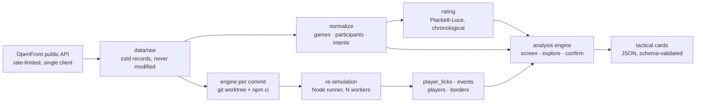

*A personal project, specified and steered by hand, written end to end with Claude Code.*

<h1 align="center">ofa — OpenFront Analyzer</h1>

<p align="center">
  <b>Collect real games, replay them in the real engine, and only then say what wins.</b><br>
  A data pipeline written end to end with Claude Code — and a harness built to keep it honest.
</p>

<p align="center">
  
  
  
  
  
  
  
</p>

<p align="center">
  <a href="#what-it-does">What it does</a> |
  <a href="#the-vibe-coding-part">The vibe-coding part</a> |
  <a href="#pipeline">Pipeline</a> |
  <a href="#what-the-harness-caught">What the harness caught</a> |
  <a href="#results-so-far">Results</a> |
  <a href="#run-it">Run it</a>
</p>

## What it does

[OpenFront.io](https://openfront.io) is a browser RTS. Its public API archives every finished
game: the final stats of each player, the winner, and `turns[]` — the log of player **commands**.
It does not archive the game itself: no territory over time, no gold or troop curves, no alliance
timeline, no who-attacked-whom-when.

So ofa does the only thing that recovers them: it **replays each archived game through the real
game engine, built at the exact commit that produced it**, and reads the state as it unfolds. A
replay is accepted only if every final stat it recomputes is identical to the archive.

On top of those trajectories, it runs a statistical protocol designed to resist the one mistake
that ruins game analytics: *winners build more because they are winning*. Every claim is measured
in a time window, against an outcome that happens **after** that window, at equal rating, equal
position and equal neighbourhood — or it is not published.

**Highlights**

- **513 of 514** eligible games replayed with every final stat bit-identical to the archive
  (99.81%), producing **74.3 million rows** of trajectory in 278 MB.
- A **chronological rating** (Plackett-Luce, online) that beats both naive baselines on a held-out
  sample: log-loss **0.6367 vs 0.6931**, rank correlation **0.311 vs 0.109** for mere experience.
- An analysis engine whose **negative control is null**: a placebo behaviour drawn six ways
  returns no effect, while a planted +0.10 effect is recovered to ±0.02 and an effect that comes
  only from player skill is rejected — although its raw association is +0.4.
- Statistics that **refuse to run**: a hypothesis is written down before it is tested, the
  confirmation sample is opened **once per hypothesis**, and the code refuses a second read.
- Two findings that contradict common wisdom, already visible **on the exploration sample and not
  yet confirmed**: in Team mode, asking for an alliance in the opening goes with **−13.6 points of
  team win rate**; in FFA, stacking defense posts early goes with **747 fewer ticks of survival**.
  Neither is published until the held-out sample says so.

## The vibe-coding part

**Every line of this project was written by Claude Code.** I wrote none of it, and that is not
what makes it interesting. What I built is the harness that makes an agent trustworthy on a
project it could easily fake its way through — because statistics are exactly where a model can
produce something that looks like a result.

| The harness | Why it exists |
|---|---|
| `docs/SPEC.md` | The contract, written before any code: scope, non-negotiable constraints, and a **mandatory rigour section** the agent cannot argue its way out of. One milestone at a time, stop and wait. |
| `CLAUDE.md` | Loaded every session: commands, architecture rules that need an ADR to change, and a growing list of **measured traps** (`bigint` stats serialised as strings, `publicID` null or `REDACTED`, 1 tick = 100 ms, the engine is only deterministic at the record's commit). |
| 12 ADRs in `docs/adr/` | Every structural decision, with the options, the measurement and how to re-check it. Changing one is a conversation, not a diff. |
| `.claude/hooks/gate.sh` | Blocks the end of a turn if the fast tests fail. The agent cannot declare victory over a red suite. |
| `.claude/skills/tactic/` | A slash command that forces the full protocol on any tactical claim: pre-register, explore, confirm once, test robustness, publish, get reviewed. |
| `.claude/agents/stats-reviewer.md` | A subagent whose only job is to **refute** a finding before it is published. |
| `.claude/rules/*.md` | Rules loaded only when the agent touches analysis or re-simulation, so the context stays clean. |
| `docs/PROGRESS.md` | What was done, with the numbers, the decisions **and the limits** — including everything that turned out false. |

The result, after 37 commits: **4 371 lines of Python**, 753 of TypeScript, 1 897 of tests and
**3 661 lines of documentation**. The documentation is not decoration; it is the part that makes
the next session as good as the last one.

## Pipeline



Two rules hold the whole thing together: **`data/raw` is never modified** — everything else is
rebuilt from it — and **Parquet is the source of truth**, read-only for everything downstream.

## What the harness caught

This is the part I would show in an interview. None of these were found by reading the code; all
of them were found because the project forces a measurement next to every claim.

- **A benchmark that accused the wrong variable.** Milestone J3 reported throughput falling from
  1 008 to 615 ticks/s and blamed worker saturation. J4b re-ran the same 16 real games at 1, 4, 6,
  8, 12, 16 and 20 workers: throughput *rises* to 16 workers (612 → 1 150 t/s) and 20 adds +0.9%.
  The slowdown came from the geography feature shipped in the same run. The milestone was closed
  by deleting it — a measurement that changes no code is still a result.
- **A window that silently matched nothing.** The engine's spawn phase ends at tick 202, but state
  is only sampled every 10 ticks, so a window starting at 202 joined **zero rows**. The fix is one
  line; the guard that now refuses any window off the 10-tick grid is the real fix.
- **A guard that cried wolf.** The analysis engine's placebo "found" +4.2 points of team win rate,
  p = 0.003. Six placebo seeds on the same data: five null, one out. With ~100 clusters, a single
  placebo leaves its interval once in twenty by luck. The guard now judges the *distribution* of
  six draws.
- **Three sources of non-reproducibility, in one afternoon.** The same command returned −0.05504,
  then −0.05298, then −0.05285. Cause 1: `ntile` broke ties in Parquet read order — and thousands
  of players sit at exactly 1500, the rating prior. Cause 2: final rank used `row_number()` on a
  ranking that **has ties** by design. Cause 3: the bootstrap drew with `random()` inside a
  parallel query and numbered its clusters with no `ORDER BY`. Fixed, then locked by a test that
  asserts two identical runs agree to 1e-9 — and documents why bit-exactness is impossible
  (parallel float summation is not associative).
- **My own estimate, off by 6×.** I announced 1 h 40 to collect 48 100 full records at 8 req/s.
  Measured on the server: **1.40 req/s, 9 h 24** — the download loop is sequential, so its rate is
  the inverse of latency and the configured rate bounds nothing. Parallelising it was then
  *declined*: nobody waits for the collection, so the pipeline was restructured to let the
  re-simulation start 7 hours earlier instead.
- **A refuted assumption, on purpose.** The spec said Cloudflare blocks a game endpoint without
  `/public/`. Milestone J0 measured HTTP 200. It is written down as refuted, with the command.

## Results so far

| Milestone | State | What it delivered |
|---|---|---|
| **J0** Reconnaissance | done | Every assumption marked verified or refuted, with the command that proves it. 3 real games replayed exactly. |
| **J1** Ingestion | done | 55 952 games, resumable, `kill -9`-safe (tested), configured rate never exceeded (proven from the logs). |
| **J2** Normalisation | done | `games` (42 cols), `participants` (98 cols), `intents` (14 cols); schemas documented in `docs/DATA.md`. |
| **J3** Re-simulation | done | **513/514 valid (99.81%)**, 74.3 M rows, 65 ticks/s/core, failures classified by cause. |
| **J4** Rating | done | 1 684 613 rows, 258 354 players, 14 s for 48 100 games. Beats both baselines. |
| **J4b** Worker count | done | Hypothesis refuted by measurement; **no code change kept**. |
| **J5** Analysis engine | in progress | Engine, screening, 12 pre-registered hypotheses, method tests green. Cards pending a denser sample. |
| **J6**–**J9** | not started | Website, personal report, offline AI summaries with a number-checking validator, systemd production. |

Independent cross-checks, each runnable without trusting `ofa`'s own code:

- `rank = 1` equals the archived winner on **34 359 of 34 359** eligible FFA games, computed
  without ever reading the `won` flag.
- **1 426 259** rating transitions chain correctly, 0 breaks: `rating_after` of one game is
  `rating_before` of the player's next.
- Units recounted from the event log match the archived stats, **54 cells out of 54**.

## Run it

Python 3.12 and [uv](https://docs.astral.sh/uv/). Node 24 and a clone of the game only if you want
to re-simulate.

```sh
uv sync
uv run ofa --help
uv run pytest -q -m "not slow and not network"      # 98 tests on real records, ~15 s

uv run ofa ingest                                   # collect (rate-limited, resumable)
uv run ofa fetch-full --sample 4500 --seed 20261121 # full records, seeded superset
uv run ofa normalize && uv run ofa rating           # rebuild Parquet, then ratings
uv run ofa engines && uv run ofa resim --evict      # one engine per commit, then replay
uv run ofa resim --watch                            # progress, in another shell

uv run ofa analyze screen                           # screen candidate behaviours (exploration only)
uv run ofa analyze explore <id>                     # measure a pre-registered hypothesis
uv run ofa analyze confirm <id>                     # opens the held-out sample, ONCE
uv run ofa analyze card <id>                        # schema-validated tactical card
```

Server install, the cost of every command and the health checks are in
**[docs/SERVEUR.md](docs/SERVEUR.md)**.

<details>
<summary><b>Project structure</b></summary>

```
.
|-- ofa/                  Python: client, ingest, normalize, engines, resim, rating, analyze
|-- resim/ofa_runner.ts   the Node runner: replays a game and streams its state
|-- findings/
|   |-- prereg/           hypotheses, written BEFORE they are tested
|   |-- cards/            tactical cards, validated against card.schema.json
|   `-- reads.jsonl       the log of confirmation reads — one per hypothesis, ever
|-- docs/
|   |-- SPEC.md           the contract
|   |-- RECON.md          every assumption, verified or refuted
|   |-- DATA.md           the Parquet schemas and what they do NOT say
|   |-- PERF.md           every measurement, with the command that produced it
|   |-- SERVEUR.md        the production runbook
|   |-- PROGRESS.md       what is done, the numbers, the limits
|   `-- adr/              12 architecture decision records
|-- tests/                100 tests, on real downloaded records — the engine is never mocked
`-- .claude/              the harness: hooks, skills, rules, the stats-reviewer subagent
```

</details>

> [!NOTE]
> The documentation under `docs/` is in French, as is the day-to-day work with the agent. The
> code, the schemas and this page are in English.

## Status

The pipeline runs: collection, normalisation, re-simulation and rating are delivered and measured.
The analysis engine passes its method tests and holds 12 pre-registered hypotheses; the tactical
cards wait on a denser re-simulated sample, because the honest answer to "is this a real tactic"
needs more games than a 7-day window gives. The website, the personal report and the production
timers are next, in that order, one milestone at a time.
