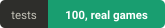
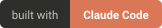
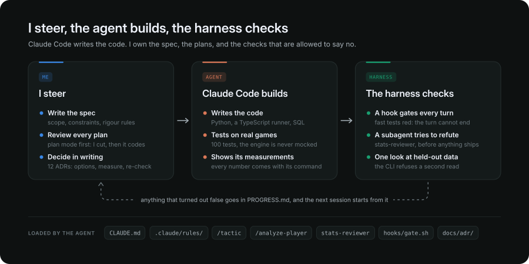
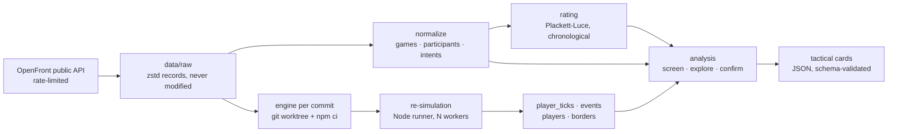
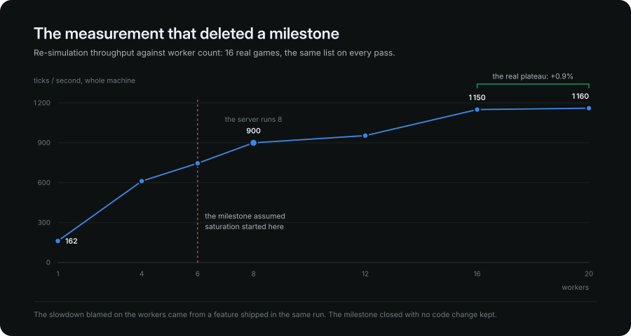
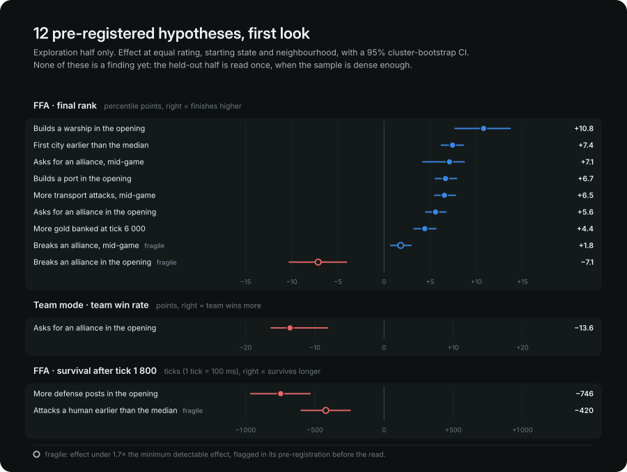
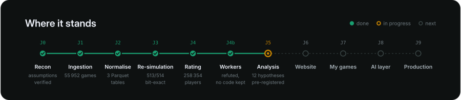

<p align="center">
  
</p>

<p align="center">
  
  
  
  
  
  
  
  
</p>

<p align="center">
  <a href="#what-it-does">What it does</a> |
  <a href="#how-i-work-with-an-ai-agent">Working with AI</a> |
  <a href="#pipeline">Pipeline</a> |
  <a href="#what-the-measurements-caught">What the measurements caught</a> |
  <a href="#first-results">First results</a> |
  <a href="#run-it">Run it</a>
</p>

## What it does

[OpenFront.io](https://openfront.io) is a browser RTS. Its public API keeps every finished game,
but only the **ending**: the final stats, the winner, and the list of commands players sent. The
game itself isn't kept: no territory over time, no gold or troop curves, no record of who attacked
whom and when.

So OFA replays each archived game **in the real game engine, built at the exact commit that played
it**, and records the state tick by tick. A replay only counts if every final stat it recomputes
matches the archive.

Then it looks for tactics that actually work, which is harder than it sounds. *Winners build more
cities* is true and useless: they build more **because** they're winning. So every claim is
measured inside a time window, against what happens **after** it, between players of equal rating,
equal position and equal neighbourhood. If it can't be measured that way, it isn't published.

**Highlights**

- **513 of 514** eligible games replayed with every final stat identical to the archive:
  **74.3 million rows** of trajectory in 278 MB.
- A chronological rating over **258 354 players** that beats both naive baselines on held-out
  games (log-loss **0.6367** vs 0.6931).
- An analysis engine that **can't fool itself**: a placebo returns nothing, a planted +0.10 effect
  comes back at ±0.02, and an effect that's really just player skill gets rejected.
- Hypotheses written down **before** they are tested, and a held-out half the code lets you read
  only once.

## How I work with an AI agent

<p align="center">
  
</p>

OFA is the project where I learned to work with an AI agent properly. Claude Code wrote the code; my
job was everything around it: deciding what to build, reviewing every plan, and setting things up
so the agent can't hand me a plausible but wrong answer. On a statistics project, plausible numbers
are the dangerous kind.

**What I learned**

- **Context is the real interface.** A spec with a rigour section the agent can't negotiate
  (bootstrap by player, effect size before p-value, "if reality contradicts this spec, stop and say
  so"), a `CLAUDE.md` loaded every session with the traps already paid for, and rules that only load
  when the agent touches analysis or re-simulation.
- **Review the plan, not the diff.** Every milestone starts in plan mode. I read it, cut what I don't
  want, and only then does a file get written. Catching a bad idea in a plan costs a minute.
- **Rules that can block, not rules that ask nicely.** A hook stops the turn when the fast tests are
  red. Permissions deny reading `.env`, editing raw data or pushing. The network is sandboxed to an
  allowlist.
- **Make the agent argue with itself.** A second agent, `stats-reviewer`, has one job: refute a
  finding before it ships. A custom skill, `/tactic`, forces the full protocol on any claim shaped
  like *"doing X helps you win"*.
- **Measure, don't trust.** No number without the command that produced it, and tests run on real
  downloaded games: a mocked engine would agree with whatever I believe.
- **Write down what was wrong.** `docs/PROGRESS.md` keeps refuted assumptions and bad estimates,
  milestone by milestone, and twelve ADRs keep the decisions. That's what makes the next session as
  good as the last one.
- **Keep changes small.** An agent's default move is to add an abstraction nobody asked for. Each
  change is the smallest one that fully solves the task.

<details>
<summary><b>The harness, file by file</b></summary>

| File | What it does |
|---|---|
| `PROMPT.md` | The brief that started the project: mission, constraints, what was already known. |
| `docs/SPEC.md` | The contract: scope, non-negotiable constraints, rigour rules, one milestone at a time. |
| `CLAUDE.md` | Loaded every session: commands, architecture rules that need an ADR to change, and known traps (`bigint` stats arrive as strings, `publicID` can be null or `REDACTED`, the engine is only deterministic at the record's own commit). |
| `.claude/settings.json` | Permissions and sandbox: no `.env`, no edits to raw data, no push, network allowlist. |
| `.claude/hooks/gate.sh` | Fast tests red: the turn cannot end. |
| `.claude/hooks/format.sh` | Formats and lints every Python file as it's written. |
| `.claude/rules/*.md` | Rules loaded only when the agent touches analysis or re-simulation. |
| `.claude/skills/tactic/` | `/tactic`: pre-register, explore, confirm once, re-test, publish a schema-validated card, hand it to the reviewer. |
| `.claude/skills/analyze-player/` | `/analyze-player`: my games against winners of the same level, same map, same moments. |
| `.claude/agents/stats-reviewer.md` | The subagent that tries to refute a finding. |
| `docs/adr/0001…0012` | Twelve decisions: the options, the measurement, and how to re-check it. |
| `docs/PROGRESS.md` | Done, numbers, decisions, limits, and everything that turned out wrong. |

</details>

## Pipeline



Two rules hold it together: **`data/raw` is never modified**, everything else is rebuilt from it,
and **Parquet is the source of truth**, read-only for everything downstream.

## What the measurements caught

<p align="center">
  
</p>

Milestone J3 saw throughput collapse and blamed the number of workers. The next milestone was
supposed to fix it. It measured it first: the same 16 real games at 1, 4, 6, 8, 12, 16 and 20
workers. Throughput **rises** up to 16. The slowdown came from a feature shipped in the same run:
two variables in one measurement, and the innocent one took the blame. The milestone closed with
**no code change kept**.

That's the pattern this setup is built for: mistakes found by a measurement, not by re-reading code.

<details>
<summary><b>Five more, same pattern</b></summary>

- **A window that matched nothing.** The spawn phase ends at tick 202 but state is sampled every
  10 ticks, so a window starting at 202 joined **zero rows**. The fix is one line; the guard that now
  refuses any window off the 10-tick grid is the point.
- **A guard that cried wolf.** The placebo "found" +4.2 points of team win rate, p = 0.003. Five
  other seeds found nothing: with ~100 clusters, one placebo misses once in twenty by luck. The guard
  now judges six draws.
- **Three sources of non-reproducibility in one evening.** The same command gave −0.05504, then
  −0.05298, then −0.05285: `ntile` breaking ties in Parquet read order, `row_number()` on a ranking
  that has ties, and `random()` inside a parallel query. Fixed, then locked by a test.
- **My own estimate, off by 6×.** I announced 1 h 40 to collect 48 100 records. The server measured
  **9 h 24**: the download loop is sequential, so the configured rate bounds nothing.
- **An assumption in my own spec, refuted.** It said Cloudflare blocks a game endpoint without
  `/public/`. Milestone J0 measured HTTP 200, wrote it down as refuted, and kept the command.

</details>

## First results

<p align="center">
  
</p>

Twelve hypotheses were committed **before** any confirmation read. On the exploration half, all
twelve go in the expected direction, and two of them go against common wisdom: in Team mode, asking
for an alliance early goes with **−13.6 points of team win rate**, while the same move in FFA goes
with a better rank. Stacking defense posts early goes with **746 fewer ticks of survival**.

None of this is published yet. The held-out half is read once per hypothesis, when about 10 000
re-simulated games make the sample dense enough. The re-simulation campaign is running on the server.

Three cross-checks anyone can run without trusting OFA's own code:

- `rank = 1` equals the archived winner on **34 359 of 34 359** eligible FFA games, computed without
  reading the `won` flag.
- **1 426 259** rating transitions chain with zero breaks: one game's `rating_after` is the next
  game's `rating_before`.
- Units recounted from the event log match the archived stats, **54 cells out of 54**.

<p align="center">
  
</p>

## Run it

Python 3.12 and [uv](https://docs.astral.sh/uv/). Node 24 and a clone of the game only if you
want to re-simulate.

```sh
uv sync
uv run ofa --help
uv run pytest -q -m "not slow and not network"      # fast tests on real games, ~15 s

uv run ofa ingest                                   # collect (rate-limited, resumable)
uv run ofa fetch-full --sample 4500 --seed 20261121 # full records, seeded superset
uv run ofa normalize && uv run ofa rating           # rebuild Parquet, then ratings
uv run ofa engines && uv run ofa resim --evict      # one engine per commit, then replay
uv run ofa resim --watch                            # progress, from another shell

uv run ofa analyze screen                           # screen candidate behaviours (exploration only)
uv run ofa analyze explore <id>                     # measure a pre-registered hypothesis
uv run ofa analyze confirm <id>                     # opens the held-out sample, ONCE
uv run ofa analyze card <id>                        # schema-validated tactical card
```

Server install, the cost of every command and the health checks:
**[docs/SERVEUR.md](docs/SERVEUR.md)**.

<details>
<summary><b>Project structure</b></summary>

```
.
|-- ofa/                  Python: client, ingest, normalize, engines, resim, rating, analyze
|-- resim/ofa_runner.ts   the Node runner: replays a game and streams its state
|-- findings/
|   |-- prereg/           hypotheses, written BEFORE they are tested
|   |-- runs/             every measurement, as JSON
|   |-- cards/            tactical cards, validated against card.schema.json
|   `-- reads.jsonl       the log of confirmation reads, one per hypothesis, ever
|-- docs/
|   |-- SPEC.md           the contract
|   |-- RECON.md          every assumption, verified or refuted
|   |-- DATA.md           the Parquet schemas, and what they do NOT say
|   |-- PERF.md           every measurement, with the command that produced it
|   |-- SERVEUR.md        the production runbook
|   |-- PROGRESS.md       what is done, the numbers, the limits
|   `-- adr/              twelve architecture decision records
|-- tests/                100 tests on real downloaded games, the engine is never mocked
|-- assets/               the images on this page, and assets/src/ to regenerate them
`-- .claude/              the harness: settings, hooks, skills, rules, the stats-reviewer subagent
```

</details>

> [!NOTE]
> Everything under `docs/` is in French, like the day-to-day work with the agent. The code, the
> schemas and this page are in English.
